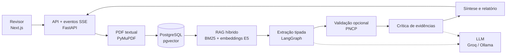

<div align="center">

# GovCheck AI

### Análise de editais públicos com IA e evidências rastreáveis

**Evidence-first AI for Brazilian public procurement documents.**

`FastAPI` · `LangGraph` · `RAG híbrido` · `Groq / Ollama` · `Next.js` · `PostgreSQL + pgvector`

[**▶ Demonstração e status do vídeo**](docs/demo.md) · [**Arquitetura**](docs/architecture.md) · [**Avaliação**](docs/evaluation.md) · [**Guia para avaliadores**](docs/reviewer-demo.md) · [**Executar no Linux**](docs/execucao-linux.md)

[](https://github.com/Cassio327/govcheck-ai/actions/workflows/ci.yml)


</div>

---

> **Por que este projeto existe?** Editais e avisos de contratação concentram datas, exigências de habilitação, critérios de julgamento e obrigações em documentos extensos. Um resumo sem fontes pode ocultar cláusulas ou induzir a erros. O GovCheck AI foi construído para **encontrar informações, organizar achados e mostrar de onde cada afirmação veio**, sem substituir a revisão humana.

## Para avaliadores técnicos — visão em 60 segundos

| Dimensão | Evidência no repositório |
| --- | --- |
| **Problema de negócio** | Editais extensos, requisitos dispersos, necessidade de decisões revisáveis e rastreáveis |
| **Entrada e saída** | PDF textual → indexação → evidências → achados estruturados → relatório Markdown/JSON e chat |
| **Arquitetura GenAI** | RAG híbrido (BM25 + E5 + RRF), LangGraph, Groq/Ollama, contratos Pydantic e FastAPI |
| **Orquestração** | Grafo de etapas especializadas: extração, checagem externa opcional, crítica de fontes e síntese |
| **Evidências** | Citações por página e estados `supported`, `unsupported`, `conflicting` para revisão humana |
| **Engenharia** | Next.js, PostgreSQL/pgvector, Docker, migrações, testes, CI e verificações de segurança |
| **Avaliação** | Três documentos de referência, 15 perguntas e 15 campos anotados; fixture determinística **não** é medição de qualidade de LLM real |

O termo *multiagente* aqui descreve **etapas especializadas coordenadas por um grafo**, não agentes autônomos sem supervisão. O uso de LLMs reais exige configurar um provedor e revisar as saídas. Este MVP não é um serviço público de produção nem substitui análise jurídica.

**Caminho recomendado:** [Vídeo e demonstração](docs/demo.md) → [Arquitetura](docs/architecture.md) → [Avaliação e limites](docs/evaluation.md) → [Execução e testes](docs/reviewer-demo.md).

## 🎬 Demonstração — execução real

**Vídeo final revisado:** **2min13s · 1080p · MP4/H.264 · 22 legendas em português incorporadas**.

**Publicação da mídia:** a edição está concluída, mas **o arquivo MP4 ainda precisa ser anexado ao GitHub**. A [issue #3 é o local preparado para o upload](https://github.com/Cassio327/govcheck-ai/issues/3), **não** um player de vídeo neste momento.

[**Roteiro, conteúdo revisado e instruções de publicação**](docs/demo.md) · [**Legendas SRT editáveis**](docs/demo-captions.srt) · [**Guia para reproduzir com LLM real**](docs/reviewer-demo.md)

O vídeo documenta uma execução com PDF público e provedor LLM, não o cenário fictício do botão de exemplo da interface:

| Cena | Evidência visual |
| --- | --- |
| **0:00–0:29 · Entrada** | Seleção e envio do PDF, processamento e seis achados estruturados |
| **0:29–1:26 · Consultas** | Perguntas sobre objeto, valor e participação, com trechos e páginas de origem |
| **1:26–1:45 · Limites** | Reconhecimento de evidência insuficiente, sem inventar percentual de multa |
| **1:45–2:13 · Saída** | Relatórios em Markdown e JSON, com citações e estados de evidência |

A [arquitetura RAG/LangGraph](docs/architecture.md) é verificável no código e na documentação; a gravação da interface **não é um benchmark de acurácia** nem certifica conformidade jurídica. A avaliação determinística usa fixtures, conforme [metodologia](docs/evaluation.md). Resultados exigem revisão humana.

## 🧠 Como funciona



**1. Indexação e recuperação.** O PDF é separado em páginas e chunks. A busca combina BM25 e similaridade semântica via RRF. A análise faz seis consultas focadas em categorias, deduplica resultados e limita o contexto a 20 trechos por documento.

**2. Workflow especializado.** Os nós do LangGraph executam extração, validação externa quando aplicável, crítica de evidências e síntese. Os dados gerados pelo LLM passam por contratos Pydantic com limites explícitos.

**3. Rastreabilidade.** Cada achado relaciona a interpretação a fontes do PDF e recebe um estado: `supported`, `unsupported` ou `conflicting`. A verificação no PNCP usa URLs e campos permitidos, sem aceitar destinos arbitrários fornecidos pelo modelo.

**4. Conversação e exportação.** O chat recupera fontes do documento selecionado e exige citações válidas; o usuário pode exportar os resultados e conferir o original.

**Decisões e tradeoffs:** [por que RAG, como o crítico funciona e quais são os limites atuais](docs/decisoes-de-engenharia.md).

## 🚀 Executar localmente

Requisitos: **Git + Docker Engine + Docker Compose v2**. A versão recomendada é Linux (Ubuntu), mas os serviços são containerizados.

```bash
git clone https://github.com/Cassio327/govcheck-ai.git
cd govcheck-ai
cp .env.example .env
nano .env
docker compose up --build -d
docker compose ps
```

Configure no arquivo `.env` antes do primeiro teste com IA real:

```dotenv
LLM_PROVIDER=groq
GROQ_MODEL=openai/gpt-oss-120b
GROQ_API_KEY=SUA_CHAVE_PRIVADA
EMBEDDING_PROVIDER=sentence-transformer
INSTALL_EMBEDDINGS=true
```

A chave é obtida no [GroqCloud](https://console.groq.com/keys) e **não deve ser enviada ao GitHub**. A senha de PostgreSQL em `.env.example` é **exclusivamente demonstrativa**: substitua-a por uma credencial forte e exclusiva antes de qualquer implantação que não seja local. Não publique o arquivo `.env`. O primeiro build com embeddings reais instala dependências maiores; o modelo pode baixar pesos na primeira utilização. Alternativamente, há um adaptador Ollama para execução local.

| Serviço | Endereço |
| --- | --- |
| Interface | http://localhost:3000 |
| Documentação interativa da API | http://localhost:8000/docs |
| Healthcheck | http://localhost:8000/health |
| Prontidão do banco | http://localhost:8000/ready |

Para encerrar sem apagar os dados: `docker compose down` (não use `-v` sem intenção de remover volumes).

**Guias:** [Linux passo a passo](docs/execucao-linux.md) · [Windows](docs/validacao-llm-real.md) · [Demonstração para revisão](docs/reviewer-demo.md).

## ✅ Qualidade e avaliação

O repositório inclui testes da API e domínio, migrações reais em PostgreSQL, testes de componentes e Playwright, análise de acessibilidade, auditoria de dependências, Gitleaks, avaliação determinística e build das imagens Docker.

[**Acompanhar o GitHub Actions**](https://github.com/Cassio327/govcheck-ai/actions/workflows/ci.yml)

A avaliação versionada possui **três documentos de referência, 15 perguntas e 15 campos anotados**. A fixture reproduzível verifica o funcionamento das métricas, mas seus números **não são acurácia de um modelo real**. Resultados de Groq/Ollama precisam ser coletados e revisados separadamente.

[Metodologia e resultados de teste](docs/evaluation.md) · [Modelo de ameaça](docs/threat-model.md) · [Contribuição](CONTRIBUTING.md) · [Segurança](SECURITY.md)

## 📂 Organização do código

```text
apps/
  api/                 FastAPI, domínio, RAG, nós LangGraph, adapters e testes
  web/                 Next.js, componentes, fluxo de revisão e testes E2E
packages/
  evaluation/          Dataset versionado, métricas e runner ao vivo
docs/
  demo.md              Roteiro revisado, limites e procedimento de publicação
  demo-captions.srt     22 legendas sincronizadas com o vídeo revisado
  architecture.md      Fluxo, integração PNCP e limites técnicos
  decisoes-de-engenharia.md  Decisões e tradeoffs de implementação
  evaluation.md        Métricas e metodologia
  threat-model.md      Riscos e fronteiras de segurança
  execucao-linux.md    Instalação e execução em Ubuntu/Linux
compose.yaml           Orquestração local e migrações do banco
.github/workflows/ci.yml  Integração contínua e verificações de segurança
```

## ⚠️ Limites e próximos passos

**GovCheck AI é um MVP para análise preliminar, não um parecer jurídico e não um serviço de produção.**

- Requer PDFs com texto selecionável; não há OCR integrado.
- Sessões são anônimas e não substituem autenticação/controle de acesso de produção.
- A busca usa vetores persistidos em pgvector, mas o ranking atual ocorre em memória, sem índice ANN de busca.
- A retenção, as filas e os limites de requisição precisariam ser endurecidos antes de um deploy público.
- Os resultados exigem comparação manual com o documento original; a validação de qualidade com LLM real é uma etapa separada.

**Próximos objetivos:** medir recuperação e factualidade com editais reais, adicionar OCR opcional, autenticação, workers persistentes e observabilidade.

---

<div align="center">

**Do documento à evidência — com revisão humana no controle.**

[Documentação](docs/architecture.md) · [Demo](docs/demo.md) · [Testes](https://github.com/Cassio327/govcheck-ai/actions/workflows/ci.yml)

</div>
