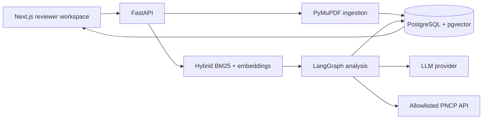

# GovCheck AI

**Evidence-first AI assistant for reviewing Brazilian public procurement notices.**

GovCheck AI turns a text-based *edital* into a structured, reviewable workspace. It extracts deadlines, required documents, estimated values, evaluation criteria, sanctions, and obligations; shows page-level evidence; checks compatible public identifiers against the PNCP; and exports a traceable report.

> **Important:** This is a portfolio prototype for preliminary document review, **not** a legal-compliance certification or legal advice. Findings require human verification.

## What you can try

| Capability | What it does | Boundary |
| --- | --- | --- |
| PDF ingestion | Validates text PDFs (up to 5 MiB / 50 pages), extracts pages, builds isolated chunks | Scanned PDFs need OCR before upload |
| Evidence-first RAG | Combines lexical BM25 and embedding rankings with reciprocal rank fusion; six focused queries improve category coverage | Evidence is scoped to the uploaded document; citations are checked against retrieved chunks |
| Multi-stage analysis | LangGraph: extraction → allowlisted external check → evidence critic → synthesis | Agent judgements are fallible and require review |
| Public-data verification | Checks a PNCP procurement identifier using a constrained HTTP tool | Unavailable/invalid checks are never reported as verified |
| Document chat | Answers questions and displays page citations or an explicit no-evidence response | Does not guarantee that cited passages fully establish a claim |
| Report export | Markdown or JSON report with findings, citations, and external-validation provenance | Preliminary, nonbinding report |
| Review UI | Responsive reviewer workspace, progress replay, category filters, accessible statuses | Example document is fictional UI data and **not** an analyzed PDF |

## Architecture



The API uses application/domain/infrastructure boundaries. Analysis persists events for resumable polling over SSE; findings retain evidence states (`supported`, `unsupported`, `conflicting`). Detailed boundaries are in [Architecture](docs/architecture.md), [Threat model](docs/threat-model.md), and [Evaluation](docs/evaluation.md).

For multilingual E5 retrieval, the adapter prefixes indexed text with `passage: ` and queries with `query: `. The retrieval ranking currently happens in application memory after document filtering; pgvector is used for storage, not approximate-nearest-neighbor search. The analysis context is bounded to 20 distinct source chunks. These are engineering choices, **not** proven accuracy gains without an evaluation run.

**Stack:** Python 3.12, FastAPI, Pydantic, SQLAlchemy, Alembic, PostgreSQL/pgvector, LangGraph, PyMuPDF, Next.js, React, TypeScript, pnpm, Vitest, Playwright, pytest, Docker Compose, GitHub Actions.

## Quick start: interface and deterministic infrastructure

Prerequisite: Docker Desktop / Docker Engine with Compose.

```bash
git clone https://github.com/Cassio327/govcheck-ai.git
cd govcheck-ai
git switch feature/govcheck-mvp
docker compose up --build
```

Open **http://localhost:3000** (UI) or **http://localhost:8000/docs** (API). To demonstrate the interface without a real edital or LLM, select **Usar edital de exemplo**. This loads **fictional, hard-coded UI fixtures**, including citations and conversations; it does not invoke the extraction pipeline.

The default Docker Compose configuration uses `LLM_PROVIDER=fake` and `EMBEDDING_PROVIDER=fake`, suitable for automated tests and infrastructure smoke checks only. **Uploading a document in this default configuration is not a meaningful real-model demonstration**: the fake LLM is a contract stub, not a document analyst. For actual extraction and document chat, configure a real model as below.

To stop, run `docker compose down`. Add `-v` only when you intentionally want to delete the local PostgreSQL data volume.

### Use a real model

You can use a hosted Groq-compatible provider or a locally installed Ollama model. These are **options**, not proof that any particular provider/model has been evaluated end-to-end.

**Groq** (requires an API key):
```bash
export LLM_PROVIDER=groq
export GROQ_API_KEY=your_key_here
# Optional: export GROQ_MODEL=your_supported_model
docker compose up --build
```

**Ollama** (local model, optional embedding add-on):
```bash
export LLM_PROVIDER=ollama
export EMBEDDING_PROVIDER=sentence-transformer
export INSTALL_EMBEDDINGS=true
docker compose --profile ollama up --build -d
docker compose exec ollama ollama pull llama3.2:3b
```

For local Ollama, allow the model download to complete before submitting PDFs. The first sentence-transformer embedding run also downloads model weights and requires additional CPU/RAM. A Groq API key is not required in Ollama mode. If you need only the lighter deterministic indexing path, leave `EMBEDDING_PROVIDER=fake` and `INSTALL_EMBEDDINGS=false`, but note that retrieval quality will not represent real embeddings.

**Data privacy:** do not upload secret or sensitive records. External LLM providers receive relevant document excerpts. Browser sessions are anonymous capabilities, not accounts; the service is not designed to handle confidential procurement materials.

### Service/API examples

All document routes require `X-Session-ID` (an arbitrary stable client session identifier).

```bash
curl -s http://localhost:8000/health
curl -s http://localhost:8000/ready
curl -X POST http://localhost:8000/api/v1/documents \
  -H 'X-Session-ID: local-demo-session' \
  -F 'file=@/path/to/edital.pdf'
```

Use the returned document UUID to start `POST /api/v1/documents/{document_id}/analysis`, then GET `/events`, `/findings`, `/report?format=markdown`, or POST `/chat`. Full request and response contracts are exposed via `/docs`.

## Run tests

Local developer prerequisites: Python **3.12**, Node.js **24**, pnpm **11.25.0**, and (for the full database integration suite) PostgreSQL/pgvector.

```bash
make install
make verify
```

`make verify` checks Python lint/tests, generated TypeScript API contracts, frontend component tests/build, and the deterministic evaluation harness. The GitHub Actions pipeline additionally runs migrations against PostgreSQL, audits dependencies, scans committed secrets, and exercises the Playwright reviewer flow. The Playwright tests use network fixtures; they do **not** certify a live LLM response.

For a reproducible deterministic evaluation dataset and methodology, see [Evaluation](docs/evaluation.md). Its baseline is **not** a real-world model benchmark; it intentionally includes erroneous examples to verify that scoring catches them.

## Security and operational limitations

- Document access is scoped to an anonymous session ID; there is **no user authentication**.
- Documents expire after 60 minutes. Physical deletion requires scheduling `govcheck-cleanup` (recommended every 10 minutes); backups and external LLM retention are outside this prototype.
- The rate limiter runs in memory per replica. Public deployment needs edge/distributed protection, persistent job orchestration, resource quotas, and stronger identity controls.
- PDF inputs are untrusted. Parsing is isolated in an unprivileged container but the demo is not hardened for hostile public production traffic.
- PNCP checks validate an allowlisted identifier and return explicit unavailable/not-found states. Results are supporting context, not compliance decisions.

## Project map

```text
apps/api/               FastAPI, application workflow, persistence, provider adapters, tests
apps/web/               Next.js reviewer UI, component and E2E tests
packages/evaluation/    Labeled sample dataset, metrics, reproducible test harness
docs/                   Architecture, evaluation, threat model
compose.yaml            Local service orchestration
.github/workflows/      CI, security scans and checks
```

## Status and next steps

The implementation is a **portfolio MVP in validation**, not a deployed production service. Next improvements include a separately reported real-provider benchmark, production-grade authentication, reliable background workers, OCR for image-only PDFs, distributed throttling, and production observability. No quantitative accuracy claim should be inferred from the deterministic fixtures.

Developed as a practical exploration of retrieval-augmented generation, multi-step LLM workflows, explainability, and safe AI-assisted review in GovTech.
