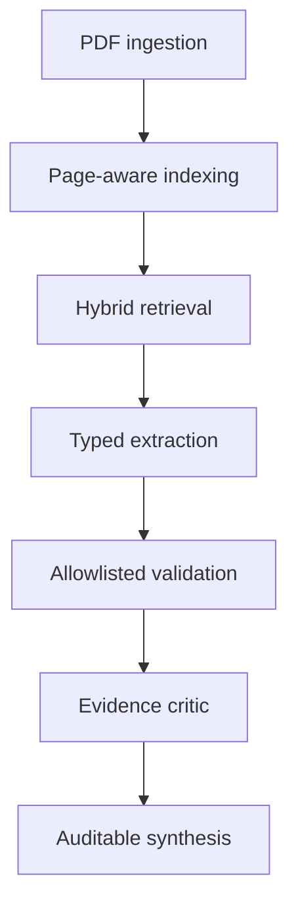

# GovCheck AI — Architecture Notes

## Product boundary

GovCheck AI performs preliminary, evidence-grounded reading of Brazilian public procurement
documents. It does not issue a legal opinion or certify compliance. Document text is always treated
as untrusted data, and every factual result must retain a page-level citation or an explicit
`unsupported`/`conflicting` status.

## Analysis flow



The analysis workflow is a typed LangGraph state machine. Extraction, external validation,
evidence criticism, and synthesis are separate nodes. PDF parsing, persistence, API transport, and
SSE delivery remain infrastructure rather than being presented as “agents.” Each node appends a
monotonic event for replay and debugging.

## Official external source: PNCP

Checked on 3 November 2026 against the official [PNCP consultation Swagger](https://pncp.gov.br/api/consulta/swagger-ui/index.html)
and [PNCP Integration Manual](https://pncp.gov.br/manual/pt-br/latest/singlehtml/).

The first production tool validates a PNCP procurement control number with the public consultation
endpoint:

```text
GET https://pncp.gov.br/api/consulta/v1/orgaos/{cnpj}/compras/{ano}/{sequencial}
```

The official control-number mask for a procurement is
`99999999999999-1-999999/9999`. The adapter decomposes that identifier locally and never accepts a
host, URL, path, method, or headers from model output. The returned `numeroControlePNCP` must equal
the requested identifier before the result can be marked `verified`.

Only these response fields may be persisted:

- `numeroControlePNCP`, `numeroCompra`, `anoCompra`, and `processo`;
- `objetoCompra`, `modalidadeNome`, and `situacaoCompraNome`;
- `dataAberturaProposta` and `dataEncerramentoProposta`.

Every execution stores the fixed tool name, sanitized identifier, status, source URL, timestamp,
whitelisted response, and stable error code. `404` becomes `not_found`; malformed payloads,
timeouts, rate limits, and upstream failures never become successful validations. Only transient,
idempotent GET failures receive one bounded retry.

Tests use a sanitized fixture derived from the documented response contract and make no live PNCP
request. This keeps CI deterministic while the source and check date remain explicit.

## Retrieval quality and bounded model outputs

The selected `intfloat/multilingual-e5-small` adapter distinguishes `passage: `
embeddings for indexed PDF chunks from `query: ` embeddings for search questions.
This follows its documented retrieval convention. Other embedding models receive
their input unchanged unless they explicitly implement model-specific formatting.

Structured edital analysis issues six focused retrieval queries (deadlines,
qualification documents, values, evaluation criteria, sanctions, obligations),
then merges results round-robin with document-ID isolation, chunk-ID
deduplication and a 20-source limit. This makes coverage of distant sections
more likely than a single broad query; **it does not guarantee recall**.

The extraction schema accepts at most 20 findings, 6 citations per finding,
a 255-character title and a 2,000-character value. The critic accepts at most
20 decisions. Identical PNCP identifiers are checked once per analysis while
each associated finding retains a distinct status. Failures to satisfy
structured-output constraints fail the analysis rather than silently writing
unbounded results.

This RAG pipeline uses an in-memory BM25/embedding ranking of chunks already
filtered by document ID, not an ANN index query. PostgreSQL/pgvector stores
vectors but the present search implementation does not use approximate vector
indices. Add indexed vector retrieval and measure recall/latency before claiming
production-scale performance.
