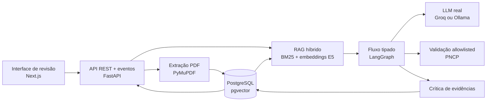

# Decisões de engenharia — GovCheck AI

Este documento registra os critérios de projeto que um avaliador técnico pode
verificar no código. O objetivo não é apresentar a arquitetura como "pronta
para produção", mas explicitar decisões, alternativas e seus limites.

## Visão geral

As quatro etapas centrais da análise são **extração, validação externa,
crítica de evidências e síntese**. Elas são nós especializados de um workflow
controlado, não agentes independentes com autonomia irrestrita.

## ADR-01 — RAG em vez de fine-tuning

**Decisão:** buscar trechos do próprio PDF antes de solicitar respostas ao LLM.

**Motivação:** editais mudam com frequência; fatos e cláusulas específicas
precisam de referências rastreáveis. Fine-tuning não cria, por si só, acesso
confiável à versão correta de um edital.

**Limitação:** recuperar o trecho não demonstra que o texto gerado seja
factualmente verdadeiro. Por isso há crítica de citações e revisão humana.

**Código:** `infrastructure/retrieval/hybrid.py`,
`application/chat_with_document.py`.

## ADR-02 — Busca híbrida com controle de contexto

**Decisão:** combinar BM25 e similaridade de embeddings por Reciprocal Rank
Fusion (RRF). Para a análise, seis buscas por assunto são intercaladas,
deduplicadas e limitadas a 20 fontes de um mesmo documento.

**Motivação:** cláusulas com linguagem específica podem se destacar na
busca lexical, enquanto paráfrases podem ser beneficiadas pela representação
semântica. A combinação evita depender de apenas um sinal de recuperação.

**Tradeoff:** o ranking lê chunks previamente filtrados por documento e
ocorre **em memória**. PostgreSQL/pgvector persiste vetores, mas atualmente
não há pesquisa ANN no banco. É um MVP de baixo volume, não uma solução
comprovadamente escalável para milhões de páginas.

**Código:** `infrastructure/retrieval/hybrid.py`,
`application/analysis/nodes.py`.

## ADR-03 — Contratos estritos entre modelo e aplicação

**Decisão:** receber JSON estruturado validado por Pydantic; limitar a
quantidade de findings, citações e tamanho de campos. Não persistir resultados
que violem esses contratos.

**Motivação:** LLMs podem gerar valores inesperados, listas excessivas,
identificadores inválidos e citações inexistentes. O contrato limita riscos
de persistência e torna erros detectáveis.

**Limitação:** um JSON válido ainda pode conter uma conclusão incorreta.
O crítico checa suporte e integridade de IDs de citação; não é prova
automática de conformidade jurídica.

**Código:** `domain/analysis.py`, `application/analysis/nodes.py`,
`application/chat_with_document.py`.

## ADR-04 — Ferramentas externas sob allowlist

**Decisão:** ferramentas não aceitam URL arbitrária do modelo. A consulta ao
PNCP recebe um identificador de controle, constrói uma URL restrita e
persiste apenas campos aprovados e a proveniência da resposta.

**Motivação:** reduzir risco de SSRF, vazamento e resultados impossíveis de
auditar. Um retorno indisponível não pode ser tratado como verificação
bem-sucedida. Identificadores repetidos são consultados uma vez por análise.

**Limitação:** a verificação não certifica que todas as informações legais
do edital estão corretas.

**Código:** `infrastructure/tools/procurement_lookup.py`,
`infrastructure/tools/registry.py`.

## ADR-05 — Transparência de avaliação

**Decisão:** CI determinística para regressões, conjunto versionado com
fontes oficiais para avaliação e rubrica humana separada.

**Motivação:** testes com respostas simuladas devem validar os contratos do
software; não podem ser anunciados como qualidade de GPT, Llama ou outro LLM.

**O que está demonstrado:** lint, testes, migrações, build, fluxo E2E
simulado e verificação de segurança executados pelo GitHub Actions.

**O que depende de prova adicional:** qualidade das respostas com um modelo
real e um conjunto verificado de PDFs oficiais. Resultados reais, quando
coletados, devem incluir versão do modelo, erros e limitações.

**Código:** `packages/evaluation/`; documentação em
[evaluation.md](evaluation.md).

## ADR-06 — Limites de um MVP com sessões anônimas

**Decisão:** isolar documentos por sessão, expirar dados, limitar requisições
e preservar eventos de execução.

**Motivação:** permitir um fluxo demonstrável com isolamento básico e
diagnósticos reproduzíveis.

**Limitação:** `X-Session-ID` não é autenticação. O produto não possui
usuários, papéis, cobrança, filas persistentes de jobs, limites distribuídos,
OCR nem infraestrutura cloud pronta para tráfego hostil. Nunca enviar
documentos confidenciais a provedores externos sem avaliação apropriada.

**Código:** `api/dependencies.py`, `api/middleware/`,
`application/cleanup_expired.py`.

---

## Como avaliar esta implementação

1. Leia o [README](../README.md) para entender a proposta de valor.
2. Siga a [demonstração](demo.md) ou execute a aplicação pelo
   [guia Linux](execucao-linux.md).
3. Examine os [testes automatizados](../apps/api/tests/) e
   [métricas determinísticas](evaluation.md).
4. Faça uma pergunta sem resposta explícita no edital e confira
   se o modelo indica falta de evidências em vez de inventar conteúdo.

A verificação manual das páginas originais é indispensável.
