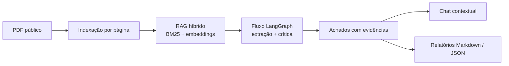

# Demonstração técnica — GovCheck AI

**[▶ Assistir ao vídeo legendado — 2min06s](media/govcheck-ai-demo-legendado.mp4)**

[Arquivo MP4 no repositório](https://github.com/Cassio327/govcheck-ai/blob/main/docs/media/govcheck-ai-demo-legendado.mp4) · [Legendas em SRT](demo-captions.srt) · [Código e README](../README.md)

## O que está publicado

| Item | Informação |
| --- | --- |
| Gravação | 12/11/2026, execução com documento público e provedor LLM real |
| Documento | Aviso de Contratação Direta nº 90007/2025 |
| Vídeo publicado | `docs/media/govcheck-ai-demo-legendado.mp4` |
| Duração | **2min06s** |
| Formato | MP4 / H.264, 1920 × 1080, sem narração |
| Legendas | **20 legendas em português** incorporadas; versão editável em SRT |

O vídeo mostra uma execução real a partir de um PDF público e foi editado para remover tempos de espera e digitação repetitiva. Nenhuma resposta foi substituída por dados simulados. O arquivo de vídeo está hospedado neste repositório; **não é um deploy público da aplicação**.

## Percurso da demonstração

| Tempo aproximado | Cena observada |
| --- | --- |
| 0:00–0:26 | Envio/processamento do documento e seis achados estruturados para revisão |
| 0:26–0:57 | Perguntas sobre o objeto e o valor estimado com referências ao edital |
| 0:57–1:23 | Pergunta sobre condições de participação e exibição das fontes |
| 1:23–1:42 | Falta de evidência suficiente para informar o percentual exato da multa |
| 1:42–2:06 | Relatório em Markdown e exportação de dados em JSON |

**Nota sobre a edição:** esta versão compacta não mostra claramente o momento de seleção do arquivo no diálogo do sistema operacional e faz uma transição rápida entre as exportações. A versão revisada de 2min13s preserva melhor essas ações, mas **não é o arquivo atualmente publicado**. Não confunda as duas edições.

## Arquitetura relacionada às cenas

- **Evidências:** o sistema associa trechos e páginas aos achados e indica estados `supported`, `unsupported` ou `conflicting`. As referências precisam de conferência humana.
- **Orquestração:** RAG híbrido, LangGraph, modelos de domínio e ferramentas são demonstrados na implementação. O vídeo da interface, isoladamente, não demonstra os algoritmos internos nem prova execução de uma chamada PNCP específica.
- **Limites:** a abstenção filmada é uma observação pontual, não uma taxa mensurada de alucinação. As métricas do [harness de avaliação](evaluation.md) foram produzidas com fixtures determinísticas e **não representam acurácia do Groq ou Ollama**.
- **Exemplo fictício:** o botão **“Usar edital de exemplo”** carrega fixtures de interface. Não deve ser confundido com a gravação real.

## Para avaliar o projeto

1. [Assista ao MP4](media/govcheck-ai-demo-legendado.mp4) para compreender o fluxo do usuário.
2. Leia o [diagrama e decisões de arquitetura](architecture.md).
3. Consulte a [metodologia de avaliação](evaluation.md) e suas limitações.
4. Siga o [guia do avaliador](reviewer-demo.md) e as [instruções de execução no Linux](execucao-linux.md).
5. Verifique os [cuidados de segurança](../SECURITY.md) antes de fornecer documentos ou chaves.

> **Uso responsável:** o GovCheck AI é um MVP para leitura preliminar de editais. Não fornece parecer jurídico, não certifica conformidade e não substitui revisão humana.
