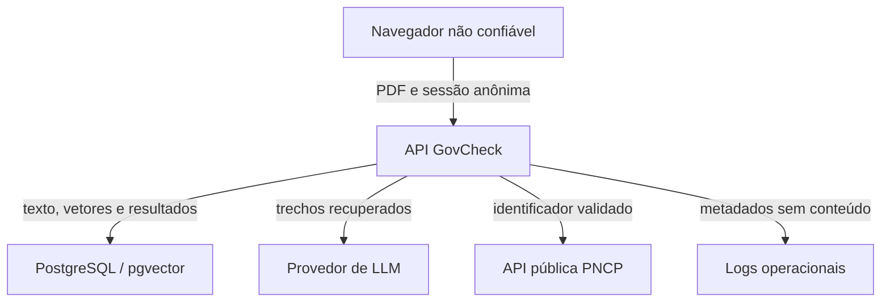

# Modelo de ameaças — GovCheck AI

**Revisão:** 7 de novembro de 2026
**Escopo:** demonstração pública para análise preliminar de editais em PDF. O sistema não autentica pessoas, não emite parecer jurídico e não deve receber documentos sigilosos.

## Fronteiras e ativos



Os ativos protegidos são o conteúdo extraído dos PDFs, embeddings, achados e citações, identificadores de sessão, credenciais de provedores, disponibilidade do serviço e integridade do relatório. As entradas do navegador, do PDF, do modelo e de APIs externas são tratadas como não confiáveis.

## Ciclo de vida dos dados

1. O PDF bruto é limitado a 5 MiB, validado e processado em memória; o binário original não é persistido.
2. Texto por página, chunks, embeddings e resultados recebem `expires_at` de 60 minutos na ingestão.
3. Após o prazo, a consulta por sessão deixa de retornar o documento imediatamente, mesmo antes da limpeza física.
4. `govcheck-cleanup` (ou `make cleanup-expired`) remove documentos vencidos e dados dependentes — páginas, chunks, jobs, eventos, achados, citações, validações e relatórios. Em produção, o comando deve ser agendado a cada 10 minutos.
5. Logs contêm apenas evento, request ID, método, template da rota, status, duração e tipo de erro. Corpos, PDFs, texto, prompts, autorização, chaves e sessões não são registrados. O container desativa o access log do Uvicorn e mantém o logger estruturado `govcheck.security` em `INFO`.

## Ameaças, controles e risco residual

| Ameaça | Controles implementados | Risco residual / operação necessária |
|---|---|---|
| Prompt injection no edital | Conteúdo entra em blocos marcados como não confiáveis; o modelo recebe somente evidências recuperadas; citações são validadas contra chunks; um crítico independente marca alegações sem suporte. | Um LLM ainda pode interpretar texto de forma incorreta. Revisão humana e aviso de uso responsável continuam obrigatórios. |
| PDF malicioso ou parser exploit | Assinatura, tamanho, número de páginas, criptografia, corrupção e ausência de texto são verificados antes de embeddings ou LLM. Dependências são auditadas na CI. | PyMuPDF processa dados hostis em processo. O deploy deve usar container sem privilégios, limites de CPU/memória e atualização rápida de CVEs. |
| SSRF e abuso de tool calling | O registro expõe somente ferramentas conhecidas; a integração PNCP constrói URLs em host HTTPS permitido, rejeita URL arbitrária, limita timeout, resposta e tentativas. | Uma falha futura na allowlist pode reabrir SSRF; testes de restrição e revisão de mudanças na ferramenta são necessários. |
| Vazamento de segredos ou conteúdo | Segredos são `SecretStr`; exceções públicas são genéricas; request IDs são validados; logs JSON usam allowlist de metadados e redator recursivo; nenhum corpo é logado; Gitleaks roda na CI. | Provedores externos recebem trechos relevantes. Não enviar material sigiloso e configurar retenção também no provedor escolhido. |
| Acesso entre sessões | Toda rota de documento valida UUID + `X-Session-ID`; respostas 404 não revelam se o UUID existe em outra sessão. IDs de sessão não são logados. | A sessão é anônima, não autenticação forte. Quem obtiver o ID pode acessar os dados até a expiração; produção sensível exigiria identidade e autorização reais. |
| Negação de serviço | Upload e páginas são limitados; janelas independentes por hash de sessão e endereço do cliente impedem bypass por simples rotação da sessão; ao atingir o limite de chaves, novos identificadores são recusados sem expulsar buckets ativos; há apenas uma análise ativa por sessão. | O limitador é local a cada réplica e a atribuição de IP depende do proxy confiável. Deploy público ainda precisa de limite distribuído/edge e cotas do provedor. |
| Corrida de análises | Uma seção crítica evita corrida no processo; índice parcial único no banco impede dois jobs `pending/running` da mesma sessão entre réplicas; conflito retorna 409. A migração invalida jobs ativos de releases anteriores e cada novo início falha jobs com mais de 10 minutos. | Não há heartbeat: uma análise legítima que exceda o lease pode ser substituída. O timeout operacional do fluxo deve permanecer menor que 10 minutos. |
| Retenção excessiva | TTL de 60 minutos bloqueia leitura; comando idempotente apaga a árvore completa de dados; cascatas permanecem como defesa adicional. | A exclusão física depende do agendamento funcionar. Alertar se o job não executar e aplicar política equivalente a backups. |
| Dependência vulnerável ou segredo commitado | CI reproduz testes, executa `pip-audit` no ambiente Python de produção, `pnpm audit` no frontend e Gitleaks no histórico completo. | Scanners têm falsos negativos e a tag de uma action é uma dependência externa; Dependabot e revisão periódica ainda são necessários. |
| Resultado tratado como decisão jurídica | Interface, API e relatórios mantêm aviso explícito; achados distinguem `supported`, `unsupported` e `conflicting`; falha externa nunca vira “verificado”. | Usuários ainda podem ignorar o aviso. O produto deve permanecer ferramenta de apoio, com responsável humano pelo ato final. |

## Controles verificáveis

```bash
make test-api
make cleanup-expired DATABASE_URL=postgresql+asyncpg://...
make verify
```

Os testes de segurança cobrem redaction e exceção segura, request IDs, rate limit, concorrência por sessão, inaccessibilidade após TTL e remoção física de toda a árvore do documento. A CI complementa esses testes com auditoria de dependências e varredura de segredos.

## Resposta operacional

- Revogar e rotacionar imediatamente uma credencial exposta; reescrever histórico somente com procedimento aprovado.
- Desabilitar o provedor afetado e manter o modo fake/local quando houver indisponibilidade ou suspeita de vazamento.
- Correlacionar incidentes apenas por `X-Request-ID`; nunca solicitar PDF, sessão ou chave em logs/tickets públicos.
- Em abuso, aplicar bloqueio no edge, reduzir cotas e preservar somente metadados necessários à investigação.
- Se a limpeza falhar, bloquear novas ingestões, executar `govcheck-cleanup` e verificar contagens antes de reabrir o serviço.
